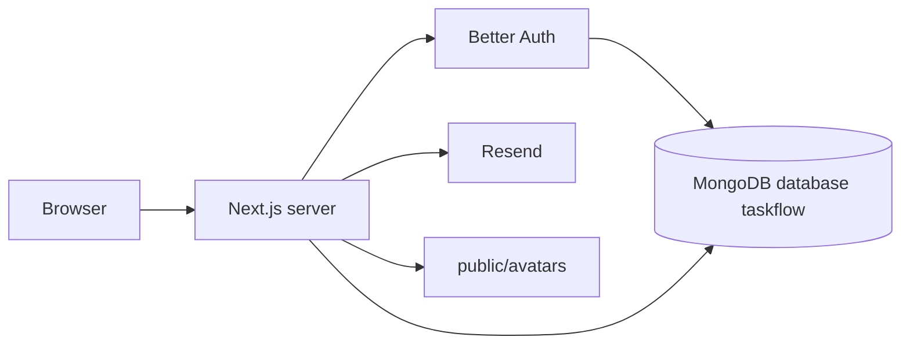

# TaskFlow Technical Documentation

Architecture and API reference for the repository as inspected on 13 October 2026. The narrative report is [TaskFlow_Project_Report.md](./TaskFlow_Project_Report.md).

## Architecture



- Better Auth uses the native MongoDB driver in `lib/db.ts`.
- Tasks use Mongoose in `lib/mongoose.ts`.
- Both use the database name `taskflow`.
- `mongodbAdapter(db)` does not pass a MongoClient, so the adapter’s transaction helper is not enabled.

## Project structure

| Path | Role |
| --- | --- |
| `app/page.tsx` | Public home |
| `app/login/page.tsx` | Login page |
| `app/register/page.tsx` | Registration page |
| `app/dashboard/layout.tsx` | Redirects to `/login` when `getServerSession` is empty |
| `app/dashboard/page.tsx` | Loads the signed-in user’s tasks with `Task.find` |
| `app/api/auth/[...all]/route.ts` | `toNextJsHandler(auth)` |
| `app/api/tasks/route.ts` | `GET` list, `POST` create |
| `app/api/tasks/[id]/route.ts` | `GET`, `PUT`, `DELETE` |
| `app/api/profile/avatar/route.ts` | `POST` profile image file |
| `components/auth/*` | Login, register, logout |
| `components/dashboard/DashboardView.tsx` | Client dashboard: search, filters, counts, create dialog |
| `components/dashboard/ProfilePhoto.tsx` | Upload control |
| `components/tasks/*` | Create, edit, delete |
| `lib/auth.ts` | `betterAuth` with email and password |
| `lib/auth-client.ts` | `createAuthClient` |
| `lib/session.ts` | Cached `getServerSession` |
| `lib/models/Task.ts` | Task schema |
| `lib/email.ts` | `sendTaskCreatedEmail` |
| `scripts/send-test-email.ts` | Developer-only email check |

There is no `middleware.ts` and no `vercel.json`.

## API reference

Session-protected routes return `{ success: false, message }` with HTTP 401 and the message “Please log in first.” when no user is present. The avatar route uses the same 401 message.

### `GET /api/tasks`

Returns `{ success: true, tasks }` for `Task.find({ userId: session.user.id }).sort({ createdAt: -1 })`. The dashboard page does not call this route. It queries Mongoose itself.

### `POST /api/tasks`

Body: `{ title: string, description?: string }`.

- Trims `title`. Empty or non-string title: 400 “Task title is required.”
- A non-string `description`: 400 “Description must be a string.”
- Invalid JSON: 400 “Invalid JSON body.”
- Creates `{ title, description, userId: session.user.id }`. Status defaults to `pending`.
- Calls `sendTaskCreatedEmail({ to: session.user.email, taskTitle })`.
- Email failure is logged. The response can still be 201 `{ success: true, task }`.
- Save failure: 500 “Could not create the task.”

### `GET /api/tasks/[id]`

Invalid ObjectId: 400 “Invalid task id.” Not owned or missing: 404 “Task not found.” Success: `{ success: true, task }`.

### `PUT /api/tasks/[id]`

Accepts any subset of `title`, `description`, and `status`. At least one must be present and valid.

- Blank title: 400 “Task title is required.”
- Non-string description: 400 “Description must be a string.”
- Status outside `pending`, `in-progress`, `completed`: 400 “Status must be pending, in-progress, or completed.” The check runs before the database call.
- `userId` in the body is ignored.
- Update uses `findOneAndUpdate` with `{ _id, userId }` and `runValidators: true`.
- Not owned or missing: 404.

### `DELETE /api/tasks/[id]`

Invalid ObjectId: 404 “Task not found.” before `connectMongoose`. This differs from GET and PUT, which use 400. Owned match: `{ success: true }` after `findOneAndDelete`. Otherwise 404.

### `POST /api/profile/avatar`

Multipart field `image`. Maximum 2 MB. JPG, PNG, GIF, or WEBP, checked by MIME type and file bytes. Writes `public/avatars/<sanitizedUserId>.<ext>`. Returns `{ success: true, image }`.

The browser then calls Better Auth `POST /api/auth/update-user` with `{ image }` so the URL is stored on the user and the session cookie is updated.

### Auth routes

`/api/auth/*` is handled by Better Auth. The UI uses `authClient.signUp.email`, `authClient.signIn.email`, and `authClient.signOut`.

## Database

### Collection `tasks`

| Field | Rules |
| --- | --- |
| `title` | Required string, trimmed |
| `description` | String, default `""`, trimmed |
| `status` | Enum `pending`, `in-progress`, `completed`, default `pending` |
| `userId` | Required string, indexed |
| `createdAt`, `updatedAt` | Mongoose timestamps |

### Better Auth data

User, session, and account documents are created by the MongoDB adapter, not by a Mongoose model in this repo. The user `image` field is a string URL when a photo has been saved. Do not document live user records here.

## Authentication

`lib/auth.ts`:

```ts
betterAuth({
  database: mongodbAdapter(db),
  emailAndPassword: { enabled: true },
})
```

`getServerSession` is `cache(async () => auth.api.getSession({ headers: await headers() }))`.

Registration password length uses Better Auth’s library default of 8 to 128 characters because `lib/auth.ts` does not set `minPasswordLength`. The registration form repeats that rule.

## Configuration

| Variable | Required for | Notes |
| --- | --- | --- |
| `MONGODB_URI` | Auth and tasks | Missing value throws at import |
| `BETTER_AUTH_SECRET` | Auth | Not passed in code. Use at least 32 characters |
| `BETTER_AUTH_URL` | Auth callbacks | Should match the site origin, including port |
| `RESEND_API_KEY` | Email | Server only |
| `EMAIL_FROM` | Email | Must be a sender Resend allows |
| `EMAIL_TEST_TO` | `scripts/send-test-email.ts` only | Not used by the task route |

Never commit values. `.gitignore` ignores `.env*` and `/public/avatars/*`.

## Development commands

```bash
npm install
npm run dev
npx tsc --noEmit
npm run build
```

`dev` and `build` use Turbopack. There is no `test` script.

## Deployment note

No deployment file is in the repository, and no live URL was verified. Profile files written under `public/avatars` are a local-disk design. See [DEPLOYMENT_GUIDE.md](./DEPLOYMENT_GUIDE.md).
