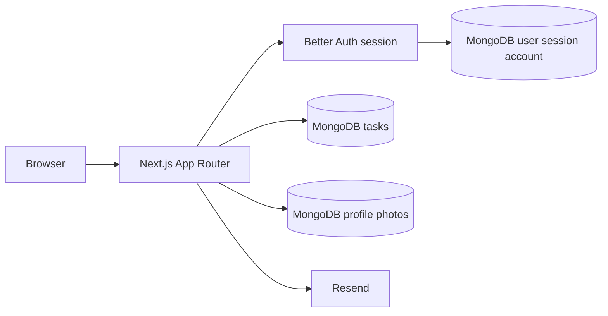
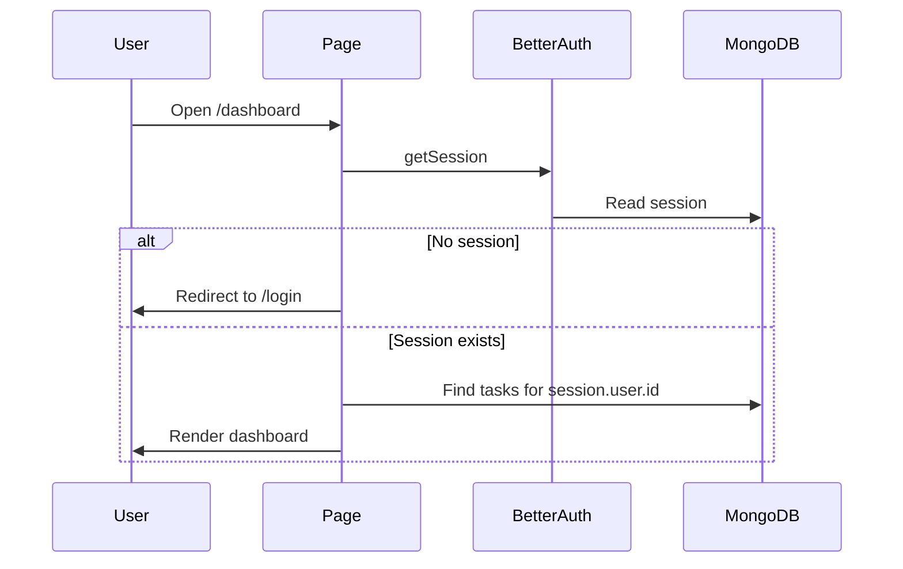
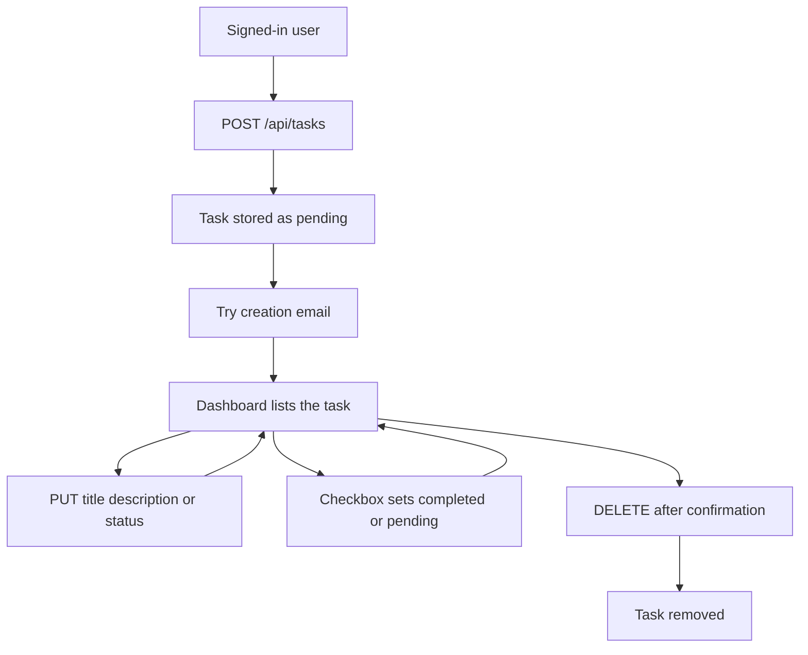

# TaskFlow Project Report

**Project title:** TaskFlow

**Document type:** Academic project report

**Prepared from:** the TaskFlow source repository

**Documentation date:** 14 October 2026. The live site is https://taskflow-gules-eight-93.vercel.app/.

| Placeholder | Fill in before submission |
| --- | --- |
| Student name | [Student name] |
| Student identifier | [Student ID] |
| Institution | [Institution] |
| Course | [Course name and code] |
| Supervisor | [Supervisor name] |
| Submission date | [Submission date] |

This report describes the application that is present in the repository. It does not invent surveys, interviews, statistics, or test results. Where a statement is a design explanation rather than a recorded study, it is labelled as a design rationale. Where a check was seen during local development but was not repeated as a formal test record, it is labelled Observed. Where the author reported a result on 14 October 2026 and this report did not repeat it, it is labelled Reported. Where no evidence exists, the item is labelled Not tested.

The author should replace the placeholders above and attach personal evidence before submission. This document is a description of the code. It is not, by itself, proof of research or testing performed by the author.

## Chapter 1: Introduction

### 1.1 Project title

The project is named TaskFlow. The name appears on the public home page (`app/page.tsx`) and in the dashboard sidebar (`components/dashboard/DashboardView.tsx`).

### 1.2 Background

People commonly keep track of work in notes, messages, or memory. A task management system is software that stores a list of pieces of work, shows their state, and lets the owner change that state. TaskFlow is a small web application of that kind. It is built for one person at a time: each account sees only the tasks stored for that account.

### 1.3 Introduction to task management systems

A typical personal task system has four operations, often called CRUD:

- Create a task.
- Read, or list, the tasks.
- Update a task, including its status.
- Delete a task.

TaskFlow implements those operations for a signed-in user. A task has a title, an optional description, and a status of `pending`, `in-progress`, or `completed`. The application also provides account registration, login, logout, a dashboard, search and status filters in the browser, a profile photo, and an email after a task is created.

### 1.4 Problem statement

The practical problem addressed by the implementation is: a person needs a private place on the web to record tasks, see counts by status, and change or remove those tasks, without another account being able to read or change them.

No separate problem-research document was supplied with the repository. The problem statement above is inferred from the features that were built.

### 1.5 Motivation

The home page states the product aim in user language: “Organize your tasks, manage your time, and stay productive every day.” The dashboard heading tells the signed-in user to “Review your work and keep the next task moving.” Those sentences are the only motivation text stored in the application. A personal reflection on why the project was chosen is not in the repository and should be written by the author.

### 1.6 Aim and objectives

**Aim.** Provide a web application in which a registered user can manage a private task list.

**Objectives visible in the implementation.**

1. Let a visitor create an account with a name, email address, and password, and later sign in.
2. Keep the dashboard available only to a signed-in user.
3. Let that user create, list, edit, complete, and delete tasks.
4. Store each task against the signed-in user’s identifier.
5. Validate task input in the browser and again on the server.
6. Show task counts and filter the visible list.
7. Send an email to the signed-in user after a task is saved, without failing the save if email fails.
8. Let the user upload a profile photo.

### 1.7 Scope of the project

**In scope, because it is implemented.**

- Public home, login, and registration pages.
- Email-and-password accounts through Better Auth.
- A dashboard with statistics, search, status filters, create, edit, status change, and delete.
- Server routes for listing, creating, reading, updating, and deleting tasks.
- Profile photo upload.
- A server-only email helper used after task creation.

**Out of scope, because it is not implemented.**

- Due dates, priorities, categories, assignments, and a scheduling calendar.
- Shared workspaces, teams, or roles beyond “this user” and “not this user.”
- Magic-link login. The authentication configuration enables email and password only.
- An automated test suite.

### 1.8 Intended users

The intended user, based on the screens, is an individual who creates an account and manages personal tasks. The application does not contain an administrator screen or a guest task list.

### 1.9 Expected benefits

If the application is running and the user is signed in, that user can see how many tasks are pending, in progress, and completed, and can change that list without editing the database by hand. Those benefits follow from the dashboard and the task routes. They have not been measured with a user study.

## Chapter 2: Research and Requirement Analysis

### 2.1 The problem TaskFlow is intended to solve

TaskFlow is intended to replace an unstructured personal list with an account-based list that the server will not show to other users. The repository does not contain a formal problem analysis, stakeholder list, or success metric.

### 2.2 Research methodology

No research notes, protocol, survey instrument, interview guide, or literature log were found in the repository. The following activities were **not performed as far as this repository shows**, and must not be described as completed work:

- User surveys.
- User interviews.
- Usability experiments.
- A recorded comparison of commercial products.
- A measured performance study.

A suitable method, if the author still needs to do it, would be:

1. Read the public documentation of a small number of existing task products and of the chosen libraries.
2. Write down comparison criteria before looking at marketing claims.
3. Record the source URL and the date of access for every claim.
4. Separate those findings from decisions already made in this codebase.

That method is a **proposed** activity. It is not evidence that it was carried out.

### 2.3 How technologies were investigated

The repository shows which technologies were installed (`package.json`) and how they are used. It does not show a diary of how alternatives were investigated. Chapter 3 therefore separates library facts, taken from official documentation or from the installed package, from design rationale.

### 2.4 Existing solutions

No comparison matrix is included, because none was supplied and inventing one would be inaccurate. Products such as personal to-do applications exist, but their current feature lists were not retrieved for this report. If a comparison is required, the author should complete it from primary vendor documentation and paste the notes into `docs/RESEARCH_AND_DESIGN.md`.

### 2.5 Functional requirements

These requirements are reverse-engineered from the working code. They describe what the system does, not a signed requirements specification.

| ID | Requirement | Where it is implemented |
| --- | --- | --- |
| FR-1 | A visitor can open a home page with links to login and registration. | `app/page.tsx` |
| FR-2 | A visitor can register with name, email, password, and password confirmation. | `components/auth/RegisterForm.tsx` |
| FR-3 | A visitor can sign in with email and password. | `components/auth/LoginForm.tsx` |
| FR-4 | A signed-in user can sign out. | `components/auth/LogoutButton.tsx` |
| FR-5 | The dashboard is not shown without a session. | `app/dashboard/layout.tsx` |
| FR-6 | The user can create a task with a title and optional description. | `CreateTaskForm`, `POST /api/tasks` |
| FR-7 | The user can see their own tasks and status counts. | `app/dashboard/page.tsx` |
| FR-8 | The user can edit title, description, and status. | `EditTaskForm`, `PUT /api/tasks/[id]` |
| FR-9 | The user can mark a task completed or return it to pending from the checkbox. | `EditTaskForm.toggleComplete` |
| FR-10 | The user can delete a task after confirmation. | `DeleteTaskButton`, `DELETE /api/tasks/[id]` |
| FR-11 | The user can search titles and descriptions and combine that with a status filter. | `DashboardView` |
| FR-12 | The user can upload a profile photo. | `ProfilePhoto`, `POST /api/profile/avatar` |
| FR-13 | Creating a task attempts to email the signed-in user. | `sendTaskCreatedEmail` in `POST /api/tasks` |

### 2.6 Non-functional requirements

These are properties the implementation aims at. They were not measured with a benchmark.

| ID | Property | What the code does |
| --- | --- | --- |
| NFR-1 | Access control | Task queries include `userId: session.user.id`. |
| NFR-2 | Server-side validation | Task routes check types and values after the browser checks. |
| NFR-3 | Secret handling | Keys are read from environment variables. They are not hard-coded in the source that was inspected. |
| NFR-4 | Email failure isolation | A failed email is logged and the create route can still return HTTP 201. |
| NFR-5 | Responsive layout | The dashboard sidebar is fixed from the `lg` breakpoint and becomes a menu below that. |
| NFR-6 | Feedback | Forms show loading text, field errors, and short-lived success messages. |

### 2.7 User needs and system constraints

A user needs an account, a modern browser, and a running TaskFlow server connected to MongoDB. Email additionally needs Resend configuration. Profile photos are stored in MongoDB and served only to the signed-in user. Successful email delivery on the live site has not been recorded.

### 2.8 Assumptions and limitations

**Assumptions visible in the code.**

- One MongoDB database named `taskflow` is shared by Better Auth and Mongoose.
- The signed-in user’s email address is an acceptable recipient for the creation email.
- A task does not need a due date or priority for the current version.

**Limitations.**

- There is no automated test suite.
- There is no recorded primary research.
- The live site is https://taskflow-gules-eight-93.vercel.app/. The author reported on 14 October 2026 that the main account, task, and profile-photo features were tested there. Screenshots are not stored in the repository.
- Creation-email delivery on the live site is not verified.
- The dashboard list is loaded by the server page, not by `GET /api/tasks`, although that route exists.

## Chapter 3: Technology Selection

The versions below are the ranges or exact versions declared in `package.json` at the time of writing. The lockfile may pin narrower versions.

### 3.1 Next.js and the App Router

**What it is.** Next.js is a React framework. Version 15.5.27 is declared. The App Router is the file-system router under `app/`. A `page.tsx` file becomes a route. A `route.ts` file becomes an HTTP endpoint. Layouts wrap the pages beneath them.

**Role in TaskFlow.** Pages live in `app/page.tsx`, `app/login/page.tsx`, `app/register/page.tsx`, and `app/dashboard/page.tsx`. The dashboard layout checks the session. API routes live under `app/api`.

**Why it fits.** Design rationale: one project can render the interface and handle HTTP without a separate backend process. Official description: the App Router is a file-system router that uses React Server Components (Next.js documentation, accessed 13 October 2026, https://nextjs.org/docs/app).

**Trade-off.** Server Components cannot use browser state. Interactive forms are marked `"use client"`. The dashboard page is a Server Component that loads tasks, then passes plain data to the client component `DashboardView`.

### 3.2 React and TypeScript

React 19.1.0 renders the interface. TypeScript is the language of the source files. The compiler option `strict` is enabled in `tsconfig.json`. Design rationale: strict TypeScript catches mismatched task fields before the application runs. A formal comparison with plain JavaScript was not recorded.

### 3.3 Tailwind CSS

Tailwind CSS version 4 is the styling system, loaded from `app/globals.css` with `@import "tailwindcss"`. Utility classes on the components define spacing, color, and layout. Design rationale: styles stay next to the markup, which suits a small interface. No design-system comparison was recorded. The home page still uses blue buttons, while the dashboard uses violet. That inconsistency is present in the code.

### 3.4 MongoDB and Mongoose

MongoDB is the database. The native driver (`mongodb` package) is used by Better Auth through `lib/db.ts`. Mongoose is used for tasks through `lib/mongoose.ts` and `lib/models/Task.ts`. Both connections use the database name `taskflow`.

Design rationale: Better Auth’s MongoDB adapter expects the native driver, while Mongoose gives the task collection a schema and validators. Using both on one database avoids a second database. The trade-off is two connection styles to understand.

`mongodbAdapter(db)` is called with the database handle only. In the installed adapter, transactions run only when a client is also configured. This project does not pass that client, so the adapter’s transaction path is not enabled. A replica set is therefore not required by the current adapter call. Hosted MongoDB clusters are often replica sets anyway. That deployment detail was not re-checked for this report.

### 3.5 Better Auth

Better Auth 1.7.7, with `@better-auth/mongo-adapter`, provides registration, login, sessions, and user records. The project enables email and password only (`lib/auth.ts`). The catch-all route `app/api/auth/[...all]/route.ts` exposes Better Auth’s HTTP handlers.

Official description: Better Auth is a TypeScript authentication framework (https://www.better-auth.com/docs/introduction, accessed 13 October 2026). The library’s own features include many plugins. TaskFlow does not enable those plugins. Password length defaults in the installed library are 8 to 128 characters when `minPasswordLength` is not overridden. That default is a library fact, not a custom TaskFlow setting.

### 3.6 Resend

Resend is the email provider. `lib/email.ts` calls `resend.emails.send` from the server only. The message is plain text: the subject is “Your TaskFlow task was created” and the body names the task title. Official guidance says the API key belongs in `RESEND_API_KEY` and a verified domain is required for production sending (https://resend.com/docs/send-with-nextjs, accessed 13 October 2026). TaskFlow follows the environment-variable part. Whether `EMAIL_FROM` uses a verified domain is a configuration fact outside the source code.

### 3.7 Other significant dependencies

| Package | Role |
| --- | --- |
| `react-dom` | Renders React in the browser and on the server. |
| ESLint and `eslint-config-next` | Static checks used by `npm run lint` and by the Next.js build. |
| `@types/node`, `@types/react`, `@types/react-dom` | Type declarations. |
| Geist font | Loaded in `app/layout.tsx` through `next/font`. |

No test runner, component library, or cloud file-storage SDK is installed.

## Chapter 4: System Analysis and Design

### 4.1 System overview

A browser talks to a Next.js server. The server checks the Better Auth session, reads or writes the `tasks` collection and the profile-photo collection, and may call Resend. The profile-photo URL stored on the user is `/api/profile/avatar`.



### 4.2 Major modules

| Module | Responsibility | Main files |
| --- | --- | --- |
| Public pages | Home, login, registration | `app/page.tsx`, `app/login/page.tsx`, `app/register/page.tsx` |
| Auth UI | Forms and logout | `components/auth/*` |
| Auth server | Session and user storage | `lib/auth.ts`, `lib/auth-client.ts`, `lib/db.ts`, `lib/session.ts` |
| Dashboard | Counts, search, filters, layout | `app/dashboard/*`, `components/dashboard/*` |
| Tasks | Create, edit, delete, status | `components/tasks/*`, `app/api/tasks/*`, `lib/models/Task.ts` |
| Email | Notify after create | `lib/email.ts` |
| Profile photo | Save an image for the signed-in user and set the user image URL | `app/api/profile/avatar/route.ts`, `lib/models/ProfilePhoto.ts`, `ProfilePhoto.tsx` |

### 4.3 Authentication and authorization flow



Authorization for a single task is the query `{ _id, userId: session.user.id }`. A missing task and another user’s task both produce “Task not found.” The client never supplies `userId`. The create route sets `userId` from the session.

Cookie presence alone is not treated as login. There is no root `middleware.ts`. The dashboard layout calls `auth.api.getSession`. Each task route calls `getSession` again.

### 4.4 Task lifecycle



### 4.5 API endpoints

All task routes return JSON. Success bodies use `success: true`. Errors use `success: false` and `message`.

| Method and path | Auth | Success | Main errors |
| --- | --- | --- | --- |
| `GET /api/tasks` | Session required | 200 `{ success, tasks }` | 401, 500 |
| `POST /api/tasks` | Session required | 201 `{ success, task }` | 400 invalid JSON, empty title, or non-string description; 401; 500 |
| `GET /api/tasks/[id]` | Session required | 200 `{ success, task }` | 400 invalid id; 401; 404 not found; 500 |
| `PUT /api/tasks/[id]` | Session required | 200 `{ success, task }` | 400 invalid id, JSON, title, description, status, or empty update; 401; 404; 500 |
| `DELETE /api/tasks/[id]` | Session required | 200 `{ success: true }` | 401; 404 for an invalid id or a missing task; 500 |
| `POST /api/profile/avatar` | Session required | 200 `{ success, image }` | 400 invalid file; 401; 500 “Could not save the profile photo.” |
| `GET /api/profile/avatar` | Session required, owner only | 200 image bytes | 401; 404 “No profile photo is saved.”; 500 “Could not load the profile photo.” |
| `GET` and `POST /api/auth/[...all]` | Better Auth | Better Auth’s own responses | Better Auth’s own errors |

`DELETE` uses 404 “Task not found.” for an id that is not a valid MongoDB ObjectId, and it does so before connecting. `GET` and `PUT` use 400 “Invalid task id.” for the same kind of id. That difference is present in `app/api/tasks/[id]/route.ts`.

The dashboard does not call `GET /api/tasks` when it paints the list. `app/dashboard/page.tsx` calls `Task.find` directly. The GET route remains available to other clients.

### 4.6 Database model

**Tasks collection.** Mongoose model name `Task`, collection `tasks`.

| Field | Rule |
| --- | --- |
| `title` | Required string, trimmed. |
| `description` | String, default `""`, trimmed. |
| `status` | `pending`, `in-progress`, or `completed`. Default `pending`. |
| `userId` | Required string, indexed. Set from the session. |
| `createdAt`, `updatedAt` | Added by Mongoose timestamps. |

There is no Mongoose relation to a User model. `userId` is a string copy of `session.user.id`.

**Profile photos.** Mongoose model name `ProfilePhoto`. One document per `userId`, enforced by a unique index. Fields are `userId`, `contentType` (`image/png`, `image/jpeg`, `image/gif`, or `image/webp`), `data` (the image bytes), and timestamps. Replacing a photo updates that document.

**Better Auth collections.** The adapter, not Mongoose, stores users, sessions, and accounts. The project does not define those schemas itself. The user record includes the fields Better Auth provides, including `name`, `email`, and `image`. After a photo upload, `image` is the URL `/api/profile/avatar?v=<time>`. This report does not dump live database contents.

### 4.7 Validation and error-handling design

Validation is layered.

1. The browser form checks required fields, email shape, password length, password confirmation, and a trimmed name.
2. The task API repeats title, description, status, and JSON checks.
3. Mongoose repeats title, trim, and status rules when a document is saved. Updates use `runValidators: true`.

Network failures in the forms set a connection message. HTTP 401 from a task call sends the browser to `/login`. Other error statuses show `message` from the JSON body, or a fixed fallback.

Creation email errors are logged on the server and are not shown as a failed task.

## Chapter 5: Implementation

### 5.1 Directory structure

```text
app/
  page.tsx                 Public home
  layout.tsx               Root layout and metadata
  globals.css              Tailwind import and body styles
  login/page.tsx
  register/page.tsx
  dashboard/layout.tsx     Session gate
  dashboard/page.tsx       Task query and counts source
  api/auth/[...all]/route.ts
  api/tasks/route.ts
  api/tasks/[id]/route.ts
  api/profile/avatar/route.ts
components/
  auth/                    Login, register, logout
  dashboard/               Dashboard view and profile photo
  tasks/                   Create, edit, delete
lib/
  auth.ts                  Better Auth setup
  auth-client.ts           Browser auth client
  db.ts                    Native MongoDB client
  mongoose.ts              Mongoose connection
  models/Task.ts
  models/ProfilePhoto.ts
  mongodb-uri.ts           Selects MONGODB_URI_PRO, MONGODB_URI_DEV, or MONGODB_URI
  email.ts
  session.ts
scripts/send-test-email.ts
types/task.ts
```

### 5.2 Registration and login

`RegisterForm` trims the name and rejects an empty result with “Full name is required.” It checks that the passwords match, that the email looks like an address, and that the password length is between 8 and 128 characters. It then calls `authClient.signUp.email`. A successful sign-up navigates to `/dashboard`.

`LoginForm` requires an email and password and calls `authClient.signIn.email`. It does not impose a minimum length, so an existing password is not rejected by the form for being short. Both forms clear the visible error when the user edits a field. Server messages are shown in an element with `role="alert"`.

### 5.3 Protected dashboard

`getServerSession` in `lib/session.ts` wraps `auth.api.getSession` in React `cache`, so the layout and the page can share one lookup in a single render. If there is no session, `app/dashboard/layout.tsx` redirects to `/login`. The page repeats that redirect and then loads tasks.

`LogoutButton` calls `authClient.signOut` and replaces the location with `/login`.

### 5.4 Creating and listing tasks

`CreateTaskForm` trims the title, rejects a blank title, and sends `{ title, description }` to `POST /api/tasks`. The route saves the task with `userId: session.user.id` and then calls `sendTaskCreatedEmail`. The form closes its dialog and the dashboard shows “Task created successfully.” for about four seconds.

The list on screen comes from `Task.find({ userId }).sort({ createdAt: -1 })`. Counts are the lengths of the pending, in-progress, and completed groups. Those three counts plus the total are the four statistic cards.

### 5.5 Editing, status, and deletion

`EditTaskForm` sends a PUT body with the trimmed title, trimmed description, and status. The checkbox sends only `{ status }`, either `completed` or `pending`. The API allows a partial update, so a status-only body is valid. After success, `router.refresh()` reloads the server page, which recalculates the counts.

`DeleteTaskButton` opens a confirmation dialog that names the task. Confirm sends `DELETE`. Cancel leaves the task in place.

### 5.6 Search and filtering

`DashboardView` keeps `query` and `statusFilter` in React state. A task is shown when its status matches the filter, or the filter is All, and when the trimmed query is empty or is contained in the title or description. Matching is case-insensitive. The statistic cards always show the full account counts, not the filtered counts. A line under the filters states how many tasks are showing when a search or a non-All filter is active.

This search does not send a new database query. It filters the tasks already passed to the browser.

### 5.7 Profile image

`POST /api/profile/avatar` requires a session. It accepts one file field named `image`. The file must be at most 2 MB. The route checks both the declared type and the file bytes for PNG, JPEG, GIF, or WEBP. It upserts one MongoDB document for `session.user.id`, so replacing a photo does not create a second document. The response image URL is `/api/profile/avatar?v=<time>`.

`GET /api/profile/avatar` returns those bytes only when the same signed-in user requests them. A missing photo returns 404 “No profile photo is saved.”

`ProfilePhoto` then sends that URL to `POST /api/auth/update-user`, which is Better Auth’s existing user-update route. The image string is stored on the user. The task schema is not changed. The dashboard shows the image only when the stored URL starts with `/api/profile/avatar`.

The author reported on 14 October 2026 that this upload works locally and that the live site’s main features were tested. This report does not include a screenshot of the upload.

### 5.8 Email notification

`sendTaskCreatedEmail` refuses to run in the browser. It requires `RESEND_API_KEY` and `EMAIL_FROM`. The recipient is only `session.user.email` at the call site in `POST /api/tasks`. The helper returns `{ success: false, message }` on failure instead of throwing for Resend’s own error. The route logs the failure and still returns the saved task with status 201.

`scripts/send-test-email.ts` is a developer script. It reads `EMAIL_TEST_TO` and calls the same helper. It does not create a task. It is not part of the user interface.

### 5.9 Environment configuration

Names only. Values must stay out of the report and out of Git. `.gitignore` ignores `.env*`.

| Name | Used by |
| --- | --- |
| `MONGODB_URI` | Development fallback in `lib/mongodb-uri.ts` |
| `MONGODB_URI_DEV` | Development URI when set. Otherwise `MONGODB_URI` is used |
| `MONGODB_URI_PRO` | Production URI. Required when `NODE_ENV` is `production`. There is no fallback |
| `BETTER_AUTH_SECRET` | Better Auth, if not passed in code. This project does not pass `secret` in `lib/auth.ts`. |
| `BETTER_AUTH_URL` | Better Auth base URL and trusted origin. Not set in `lib/auth.ts`. For the live site it must be `https://taskflow-gules-eight-93.vercel.app` |
| `RESEND_API_KEY` | `lib/email.ts` |
| `EMAIL_FROM` | `lib/email.ts` |
| `EMAIL_TEST_TO` | `scripts/send-test-email.ts` only |
| `NODE_ENV` | `lib/mongodb-uri.ts` and `lib/db.ts` |

`BETTER_AUTH_SECRET` should be at least 32 characters. That warning comes from the installed Better Auth package, not from a custom check in TaskFlow.

### 5.10 Security decisions that are actually in the code

- Task ownership comes from the session, not the request body.
- Queries combine the task id with `userId`.
- Password length is enforced by Better Auth on registration even if the browser check is bypassed.
- The profile upload checks file bytes and size, stores the bytes against the session user id, and does not accept another user’s id.
- Email errors do not include the API key in the logged message. The helper logs `error.name`.
- `.env` files are listed in `.gitignore`. `/public/avatars/*` remains ignored, but the current upload route does not write there.

The application does not add its own rate limiting, security headers, or virus scanning. Those absences are limitations, not hidden features.

## Chapter 6: User Manual

The live site is https://taskflow-gules-eight-93.vercel.app/. A common local address is `http://localhost:3000`. The port can differ if another program is using 3000. The author should replace the local address with the one shown by `npm run dev`.

### 6.1 Access TaskFlow

1. Open the home page.
2. Choose **Get Started** to register, or **Login** to sign in.

### 6.2 Create an account

1. Open the registration page.
2. Enter a full name, email address, and a password of 8 to 128 characters.
3. Enter the same password again.
4. Choose **Create account**.
5. If a field is empty or invalid, the message appears under that field and no account is created.
6. After success, the browser goes to the dashboard.

### 6.3 Log in and log out

1. Open the login page.
2. Enter the account email and password.
3. Choose **Sign in**.
4. On the dashboard, use **Log out** at the bottom of the sidebar. On a narrow screen, open the menu first. The avatar button also opens that menu.
5. After logout, the login page is shown. Opening the dashboard again returns to login.

### 6.4 Open the dashboard

The dashboard shows a greeting, four counts, and **My Tasks**. The counts are Total, Completed, Pending, and In Progress.

### 6.5 Create a task

1. Choose **Create Task**.
2. Enter a title. Description is optional.
3. Submit the form.
4. A short notification says the task was created. It can be closed and also disappears after a few seconds.
5. The new task appears in the list. Its status starts as Pending.

A title that is empty or only spaces is rejected with “Task title is required.”

### 6.6 View and filter tasks

- **All**, **Pending**, **In Progress**, and **Completed** show tasks in that status. The number on each button is the account total for that status, not only the search result.
- The search box matches the title and the description together with the selected status.
- While a search or a specific status is active, a line reports how many tasks are showing.
- If nothing matches, the page says so. It does not delete any tasks.

### 6.7 Edit a task

1. Choose the edit control on the task.
2. Change the title, description, or status.
3. Choose **Save changes**, or **Cancel** to discard the edit.
4. “Task updated.” appears briefly when the save succeeds.

### 6.8 Change status from the checkbox

The checkbox marks the task completed. Choosing it again sets the status back to pending. The counts refresh after the server accepts the change. Moving a task to **In Progress** is done from the edit form, not from the checkbox.

### 6.9 Delete a task

1. Choose the delete control.
2. Read the confirmation dialog. It names the task.
3. Choose **Delete task** to remove it, or **Cancel** to keep it.

### 6.10 Update the profile image

1. In the sidebar account area, choose the photo or **Change photo**.
2. Select a JPG, PNG, WEBP, or GIF file of 2 MB or less.
3. Wait for “Profile photo updated.”

If the file is rejected, the page shows the validation message, such as “Use a JPG, PNG, WEBP, or GIF image.” or “Image must be 2 MB or smaller.” The task list is unchanged. The author reported that upload works locally. A screenshot is still not stored in the repository.

### 6.11 Errors and email

- Red text under a field is a validation message.
- “Please log in first.” means the session is missing. The task screens send the browser to login on HTTP 401.
- “Request failed. Check your connection and try again.” means the browser could not complete the request.
- A creation email is sent only to the email address on the signed-in account. If email is not configured, or the provider rejects it, the task can still be created. The user does not see an email-failure message in the dashboard. The server log contains the failure. Delivery on the live site has not been recorded as verified.

### 6.12 Screenshots still required

No screenshot files are stored in the repository. Insert the following captures into this chapter before submission. Do not draw mock screens.

| ID | Screen | Where to insert |
| --- | --- | --- |
| S1 | Home page | Section 6.1 |
| S2 | Registration form with a validation message | Section 6.2 |
| S3 | Login page | Section 6.3 |
| S4 | Dashboard with tasks and the four counts | Section 6.4 |
| S5 | Create-task dialog | Section 6.5 |
| S6 | Search or filter result line | Section 6.6 |
| S7 | Edit form | Section 6.7 |
| S8 | Delete confirmation dialog | Section 6.9 |
| S9 | Profile photo after upload | Section 6.10 |
| S10 | Logged-out visit to the dashboard ending on login | Section 6.3 |

## Chapter 7: Installation and Developer Setup

### 7.1 Prerequisites

- Node.js with npm. The repository does not pin a Node version in an `.nvmrc` file.
- A MongoDB database that this machine can reach.
- A Resend account, only if creation emails should be sent.

### 7.2 Clone the repository

This project’s `origin` remote is configured. Clone the repository URL from that host:

```bash
git clone <repository-url>
cd taskflow
```

### 7.3 Install dependencies

```bash
npm install
```

### 7.4 Environment variables

Create a file named `.env` in the project root. Do not commit it. Use placeholders, not real secrets, in any shared document.

```text
MONGODB_URI=<local-mongodb-connection-string>
MONGODB_URI_DEV=<optional-development-connection-string>
MONGODB_URI_PRO=<production-mongodb-connection-string>
BETTER_AUTH_SECRET=<random-string-at-least-32-characters>
BETTER_AUTH_URL=<public-base-url-of-this-app>
RESEND_API_KEY=<resend-api-key>
EMAIL_FROM=<verified-sender-address>
EMAIL_TEST_TO=<address-allowed-by-the-email-provider>
```

`EMAIL_TEST_TO` is only for `scripts/send-test-email.ts`. Development uses `MONGODB_URI_DEV` when it is set, and otherwise `MONGODB_URI`. Production requires `MONGODB_URI_PRO` and does not fall back. For the live site, `BETTER_AUTH_URL` must be `https://taskflow-gules-eight-93.vercel.app`.

### 7.5 MongoDB

Create or choose a cluster and a user that can read and write the `taskflow` database. Put the local connection string in `MONGODB_URI` or `MONGODB_URI_DEV`. Put the production connection string in `MONGODB_URI_PRO`. The application selects the database name `taskflow` in code, in both `lib/db.ts` and `lib/mongoose.ts`. `lib/mongodb-uri.ts` chooses which variable to read.

Better Auth will use its own collections in that database when a user registers. Mongoose will use the `tasks` collection when a task is created and the profile-photo collection when a photo is saved. No migration script is included.

### 7.6 Better Auth

`lib/auth.ts` enables email and password and passes the MongoDB database to `mongodbAdapter`. Set `BETTER_AUTH_SECRET` and `BETTER_AUTH_URL`. For local development, `BETTER_AUTH_URL` must match the URL printed by the dev server, including the port.

### 7.7 Resend

Create an API key in Resend and set `RESEND_API_KEY`. Set `EMAIL_FROM` to an address Resend allows. Resend’s documentation states that a verified domain is required for normal production sending, and that the test sender is limited (https://resend.com/docs/send-with-nextjs, accessed 13 October 2026). A task is still saved if sending fails.

Optional check that does not create a task:

```bash
npx tsx scripts/send-test-email.ts
```

`tsx` is not listed in `package.json`. If the command cannot find it, use a runner that is already installed, or install `tsx` as a development dependency. That gap should be noted rather than ignored.

### 7.8 Start, typecheck, and build

```bash
npm run dev
npx tsc --noEmit
npm run build
```

`npm run dev` and `npm run build` both use Turbopack, as declared in `package.json`. Do not run the production build while the dev server is using the same `.next` directory if that causes missing-file errors. Stop one before starting the other, or restart `npm run dev` after a build.

### 7.9 Common setup problems

| Symptom | What to check |
| --- | --- |
| `MONGODB_URI_PRO is missing` | Production mode, including `npm run build`, does not have `MONGODB_URI_PRO`. |
| `MONGODB_URI_DEV is missing` | Neither `MONGODB_URI_DEV` nor `MONGODB_URI` is set for development. |
| Registration shows “Invalid origin” | `BETTER_AUTH_URL` does not match the site origin. On the live site it must be `https://taskflow-gules-eight-93.vercel.app`. |
| Registration or login fails immediately | `BETTER_AUTH_SECRET` and `BETTER_AUTH_URL`, and that MongoDB is reachable. |
| Dashboard redirects to login | The browser has no session. Sign in again. |
| Task is created but no email arrives | `RESEND_API_KEY`, `EMAIL_FROM`, and whether the provider allows that recipient. Read the server log. The task route still returns 201. Live delivery is not verified. |
| Profile photo does not appear | The upload response, the follow-up call to `/api/auth/update-user`, and `GET /api/profile/avatar` for the same session. |
| Internal error after `npm run build` | Restart the dev server so it can recreate its own `.next` files. |

## Chapter 8: Testing and Quality Assurance

There is no automated test suite. `package.json` has no `test` script. The table uses only results that were recorded during local development, plus explicit gaps. The author should repeat the checks and replace the Actual result column with their own notes and screenshots.

| Test ID | Feature | Preconditions | Steps | Expected result | Actual result | Status | Evidence |
| --- | --- | --- | --- | --- | --- | --- | --- |
| T-01 | Typecheck | Dependencies installed | Run `npx tsc --noEmit` | Exit code 0 | Exit code 0 on 13 October 2026, and again on 14 October 2026 after profile photos moved to MongoDB | Observed | Command output from those local runs |
| T-02 | Production build | Dependencies installed | Run `npm run build` | Build completes | Exit code 0 on 13 October 2026 and again on 14 October 2026. Next.js 15.5.27 generated the App Router pages, including `/api/profile/avatar` | Observed | Build logs from those local runs. Image-tag warnings did not fail the build |
| T-03 | Registration validation | Logged out, registration page open | Submit an empty form, a space-only name, an invalid email, and a short password | Each case shows a field message and does not create an account | Those messages were shown and the page stayed on registration | Observed | Browser check during development. Not a stored screenshot in the repo |
| T-04 | Successful registration | A new email address | Submit valid fields | Account is created and the dashboard opens | Sign-up requests returned success in earlier local use. Not repeated as a scripted case for this report | Partial | Dev-server history, not a formal record |
| T-05 | Login | An existing account | Sign in with the correct password | Dashboard opens | A development browser reached the dashboard after sign-in | Observed | Local session. Wrong-password requests also produced HTTP 401 in the dev log |
| T-06 | Protected dashboard | Logged out | Open `/dashboard` | Browser ends on `/login` | The logged-out test browser was shown the login page | Observed | Local browser |
| T-07 | Logout | Signed in | Choose Log out, then open `/dashboard` | Login page, then login page again | Sign-out returned HTTP 200 and the dashboard redirected to login | Observed | Local browser and dev log |
| T-08 | Create task | Signed in | Create a task with a title and description | HTTP 201, task appears, counts increase | A temporary task was created. The list and counts updated. The success notice appeared | Observed | Dev log `POST /api/tasks` 201 and the dashboard |
| T-09 | Empty title | Signed in or using the API | Submit a blank or whitespace title | No task is created. Message says the title is required | The form blocks this. The API returns 400 for a blank title. The API case was not repeated while writing this report | Partial | Code review of `POST`. Form behavior was implemented and reviewed |
| T-10 | Edit and status | Signed in, task exists | Change status to In Progress and save | PUT succeeds and counts change | A temporary task moved to In Progress and the three status counts changed accordingly | Observed | Dev log PUT 200 and the dashboard |
| T-11 | Checkbox | Signed in | Use the checkbox | Status becomes completed, or pending if it was completed, and counts refresh | The control calls the same PUT route. A dedicated checkbox click was not recorded as its own test row | Not tested | Code path exists in `toggleComplete` |
| T-12 | Search and filter | At least two tasks | Search a title and select a status | Only tasks that match both are listed. Account counts stay unchanged | Search limited a list to the matching task while the account totals stayed visible | Observed | Local dashboard. Description-only search was not separately recorded |
| T-13 | Delete | Signed in | Confirm delete | Task disappears and counts drop | A temporary task was deleted after confirmation. DELETE returned 200 | Observed | Dev log and dashboard counts |
| T-14 | Delete cancel | Signed in | Open delete and choose Cancel | Task remains | Cancel is implemented. A separate recorded click for this report was not kept | Not tested | Code in `DeleteTaskButton` |
| T-15 | Other user’s task | Two accounts, one task owned by the first | From the second account, list, read, update, and delete the first account’s task | List omits it. Read, update, and delete return 404 | The developer reported that a second account could not list or read the original task. Update and delete across accounts were not recorded as finished | Partial | Developer report. Not re-run for this document |
| T-16 | Invalid status | Signed in | PUT `status` set to a value outside the enum | HTTP 400 and the task is unchanged | The route contains that check. A 400 was seen in earlier API experiments. The response body was not always saved | Partial | Code and incomplete earlier logs |
| T-17 | Email success | Resend allows the recipient | Create a task | Provider accepts the message and the task is still saved | Delivery was reported during development. It was not repeated for this report, and live-site delivery is not recorded as verified | Not retested | Script `scripts/send-test-email.ts` exists |
| T-18 | Email failure still saves | Provider rejects the recipient or the key | Create a task | HTTP 201 and an error in the server log | A create returned 201 while the server logged a Resend error | Observed | Dev log from a local create. Do not copy the provider’s address into the report |
| T-19 | Profile photo | Signed in | Upload a small allowed image | Photo appears and survives refresh | The author reported on 14 October 2026 that upload works locally and that the live site’s main features were tested. This report did not repeat the click or store a screenshot | Reported | Author statement. Route stores the image in MongoDB |
| T-20 | Profile photo rejection | Signed in | Upload a non-image or a file over 2 MB | HTTP 400 and no user-image change | Not run | Not tested | Checks exist in the avatar route |
| T-21 | Narrow layout | Signed in | View around 390 CSS pixels wide | No horizontal overflow. Menu opens and contains Log out | An earlier dashboard layout was checked at 390 pixels. This exact profile-photo revision was not rechecked in the browser | Partial | Earlier local check |
| T-22 | Production host | The live site | Sign in and use the main task and profile features | Same behavior as local, with production env vars | The author reported on 14 October 2026 that those features were tested at https://taskflow-gules-eight-93.vercel.app/. No screenshot was added. Email delivery is not part of this result | Reported | Author statement on 14 October 2026 |

## Chapter 9: Deployment

The live site is https://taskflow-gules-eight-93.vercel.app/. The author reported on 14 October 2026 that the main account, task, and profile-photo features were tested there. This chapter does not add screenshots. There is no `vercel.json`. The repository has an `origin` remote. Creation-email delivery on the live site has not been recorded as verified.

### 9.1 Local development versus production

| Topic | Local | Production |
| --- | --- | --- |
| How it starts | `npm run dev` | Vercel runs the output of `npm run build` |
| URL | The dev server’s localhost URL | https://taskflow-gules-eight-93.vercel.app/ |
| `BETTER_AUTH_URL` | Must match the local URL, including port | Must be `https://taskflow-gules-eight-93.vercel.app` |
| MongoDB | `MONGODB_URI_DEV`, or `MONGODB_URI` if that is unset | `MONGODB_URI_PRO` only. The database name in code remains `taskflow` |
| Email | May use Resend’s test limits | Needs a sender Resend allows for real recipients. Live delivery is not verified |
| Profile photos | MongoDB document for the signed-in user | The same MongoDB design. No writable `public/avatars` directory is required |

### 9.2 Vercel outline

1. The project is already connected to a Git remote and to Vercel.
2. Production environment variables are `MONGODB_URI_PRO`, `BETTER_AUTH_SECRET`, `BETTER_AUTH_URL`, and, if email should be attempted, `RESEND_API_KEY` and `EMAIL_FROM`.
3. Do not set `EMAIL_TEST_TO` unless the test script will run on the host.
4. `BETTER_AUTH_URL` must be the public origin with no path. A mismatch returns “Invalid origin”.
5. Open the public URL, register or log in, create a task, and confirm that another account cannot see it.
6. Confirm the creation email only after a message is actually received. That confirmation is still missing.

### 9.3 Post-deployment checks

The author reported that the main live features were used on 14 October 2026. The checks below remain the expected behavior:

- Home, login, and registration load.
- `/dashboard` redirects when logged out.
- Creating a task returns the task to the owner.
- Logout works.
- Server logs do not print secrets.
- Profile upload stores the image in MongoDB and `GET /api/profile/avatar` returns it to the same user.

## Chapter 10: Security, Limitations, and Future Improvements

### 10.1 Protections that exist

- Sessions come from Better Auth, not from a hand-written password check.
- The dashboard and every task route require a session.
- Task reads and writes include the session user id.
- Registration passwords are checked by Better Auth as well as the form.
- Uploaded avatars are type-checked and size-limited, stored against the session user id, and returned only to that user.
- `.env` files are gitignored.

### 10.2 Risks and limitations

- No security audit was performed. This report does not say the application is fully secure or production-ready in every respect.
- There is no automated authorization test in the repository.
- Invalid id responses differ between DELETE and the other task methods.
- The home page and dashboard do not share one visual system.
- Email failure is invisible to the user. That is intentional so that a mail outage does not block task creation, but the user is not told that the message failed. Live-site delivery has not been recorded as verified.
- Search runs only on tasks already loaded into the page.
- A profile photo can be viewed only by the signed-in owner, because `GET /api/profile/avatar` checks the session.

### 10.3 Email configuration still required

`RESEND_API_KEY` and `EMAIL_FROM` must be set before a creation email can be accepted. The sender must be one Resend will accept for the signed-in recipient. A failed send must not be described as a delivered email. No record in this report shows that the live site successfully delivered a creation email.

### 10.4 Realistic future work

- Due dates and priorities, as a separate change to the task model, API, and forms.
- Add automated tests for ownership and validation.
- Show the user when email fails, without failing the create request.
- Align DELETE’s invalid-id response with GET and PUT if a consistent message is wanted.
- Record a received creation email from the live site, without copying addresses or secrets into the report.

## Chapter 11: Conclusion

TaskFlow is a personal task web application. A visitor can register and log in. A signed-in user can create, search, filter, edit, complete, and delete only their own tasks, and can upload a profile photo. Creating a task tries to send an email and still succeeds if email fails.

What was learned cannot be stated as the author’s personal reflection, because that reflection was not supplied. The repository does show a working split between a React interface, Next.js routes, Better Auth, Mongoose, and Resend.

Evidence of a typecheck and a production build exists from local commands on 13 October 2026 and again on 14 October 2026. Several dashboard flows were also seen locally. The author reported on 14 October 2026 that the live site at https://taskflow-gules-eight-93.vercel.app/ was used to test the main account, task, and profile-photo features. Screenshots are not in the repository. A full cross-account update and delete test, profile-photo rejection, and live email delivery were not established by this report.

Future work can add due dates and priorities without pretending those fields exist today.

## References

References below were either retrieved or are named as official documentation still to be retrieved. No journal articles were invented.

1. Vercel. “App Router.” Next.js documentation. https://nextjs.org/docs/app. Accessed 13 October 2026.
2. Better Auth. “Introduction.” https://www.better-auth.com/docs/introduction. Accessed 13 October 2026.
3. Resend. “Send emails with Next.js.” https://resend.com/docs/send-with-nextjs. Accessed 13 October 2026.

The following official addresses are the intended citations for the other major technologies. They were **not retrieved** while this report was written. Confirm each page before submission.

4. TypeScript documentation. https://www.typescriptlang.org/docs/
5. Tailwind CSS documentation. https://tailwindcss.com/docs
6. MongoDB manual. https://www.mongodb.com/docs/manual/
7. Mongoose guide. https://mongoosejs.com/docs/guide.html
8. Vercel deployments documentation. https://vercel.com/docs

## Appendix A: Glossary

| Term | Meaning in this project |
| --- | --- |
| App Router | Next.js routing based on the `app` directory. |
| Session | The signed-in state stored by Better Auth and read with `getSession`. |
| CRUD | Create, read, update, and delete. |
| ObjectId | The identifier format Mongoose uses for `_id`. The task routes check it with `isValidObjectId`. |
| Status | One of `pending`, `in-progress`, and `completed`. |
| Server Component | A React component rendered on the server. The dashboard page is one. |
| Client Component | A component with `"use client"` that can use state and click handlers. |

## Appendix B: API summary

See section 4.5. The dashboard list uses a direct database read in `app/dashboard/page.tsx` in addition to the GET route.

## Appendix C: Environment variable reference

See section 5.9. Do not paste values.

## Appendix D: Test evidence index

| Evidence | Where it lives |
| --- | --- |
| Typecheck and build output | Local terminal on 13 and 14 October 2026. Not committed as a file |
| Browser observations | Described in Chapter 8. Screenshots are not in the repository |
| Email failure with a successful create | Development server log. Do not archive the log if it contains a personal address |
| Live site | https://taskflow-gules-eight-93.vercel.app/. Author reported main-feature testing on 14 October 2026. Email delivery is not verified |
| Missing evidence | Profile-photo rejection, full cross-user update and delete, a received live creation email, author-owned screenshots |

## Appendix E: Screenshot index

See section 6.12. All ten captures are still required in the repository or the submitted PDF.
